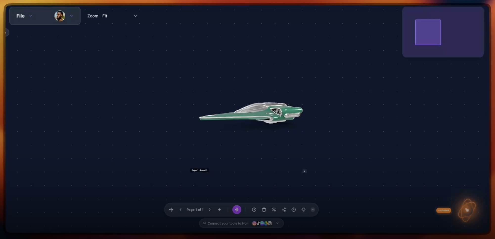
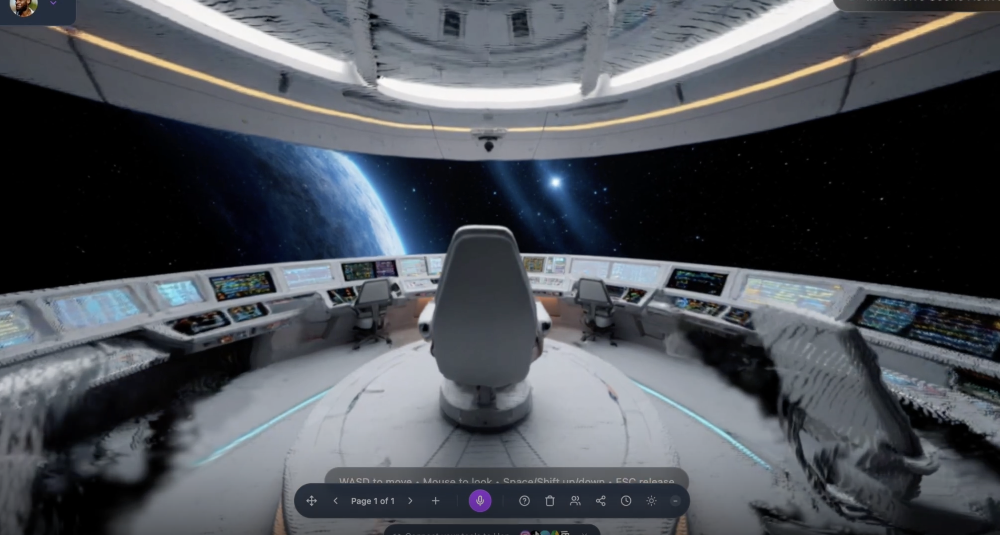

# Hon

A canvas I control by talking with an AI in real time.

I speak to Hon, it speaks back, and it uses tools to work on the canvas. Those tools are image, video, audio and 3D generation models, plus the controls for adding, arranging and changing things. I want the conversation and the things we make to stay together.

**This is an unfinished personal experiment.** I'm sharing the canvas code and screenshots. This release is for local use. Setup needs accounts and configuration for the parts you want to use.

<p align="center"></p>
<p align="center"><sub>My Hon canvas during a speech-to-speech session, with a generated image on the canvas. The orb at the bottom right is Hon's voice indicator; its badge shows what Hon is doing.</sub></p>

## The idea

I want to talk through an idea, see the result, and keep working on it in the same place. Images, video, sound, 3D assets, and the conversation that produced them should stay together.

I do these experiments for fun. Hon started as a comic creator, and I've kept pulling it toward an open canvas, voice tools, and interactive scenes. Some of the older names and code still reflect that starting point; the npm package is still called `panels-comic-reader`.

This is a work in progress. I'm trying ideas, keeping the useful parts, and finding the places where the interface looks further along than the underlying workflow.

## What I can do with it, and what is still being connected

The conversation is part of how I control the canvas. Hon uses tools during the speech-to-speech session: it can call a generation model, work with the result, and change the canvas. I can also edit directly, move things myself, and continue talking from there.

| Area | What I'm working toward | Where it is in this repo |
|---|---|---|
| Speech-to-speech | Talk to Hon, hear it answer, and have it act on the canvas | The browser connects to Hume's Empathic Voice Interface (EVI) and runs the tool calls it sends. It needs a Hume account and an EVI configuration set up in the Hume dashboard. Exporting that configuration is still to do. |
| Generation tools | Image, video, audio and 3D models as tools Hon can call | Adapters for many providers sit under `api/`. Each needs its own provider key. Several integrations remain unfinished ([integration status](docs/INTEGRATION_STATUS.md)). |
| Canvas controls | Add, arrange, inspect and change things on the canvas by voice | Tools in `src/services/humeEviService.ts` read and change the canvas state directly. |
| 3D scenes | Move between a flat canvas and a scene I can explore | Scene tools built around PlayCanvas: loading 3D assets, placing objects, characters and NPCs. The voice scene builder runs model-generated code in the app page. |
| Gaussian splats | Turn an image on the canvas into a scene I can walk through | Image to splat through Apple's SHARP on a Modal GPU worker. Image input only. |
| Video to splat | A reproducible pipeline in its own repo | Planned as a separate experiment. The current branch accepts images. |
| Collaboration and saved projects | Keep my work and share it with people I choose | Code is here. Canvas history needs a Supabase database session. Collaboration is waiting on its database migrations. |
| Access | A private experiment for me and a few allowed people | Every `/api` route checks for a verified Supabase or Privy sign-in and an explicit allowlist; the Google and Notion OAuth callbacks check signed state from an authenticated start. Parts of sign-in and voice are still being reworked. |

Each integration needs its own credentials, setup and connected testing. The status page records the current gaps.

I'm especially interested in moving between a flat canvas and a scene I can explore. That includes loading 3D assets, placing objects, working with characters, and bringing Gaussian splats into the same workspace.

<p align="center"></p>
<p align="center"><sub>A 3D asset on my canvas, with the voice and page controls visible.</sub></p>

## How it works

### The conversation loop

1. The browser asks `/api/hume/generate-token` for a Hume access token and the EVI config ID. That route, like every `/api` route, needs a verified sign-in.
2. The browser opens an EVI chat and streams microphone audio to it.
3. EVI answers with speech and, when it decides to use a tool, sends a tool call by name.
4. `src/services/humeEviService.ts` runs the tool. It either calls a server route under `/api` (generation, Notion, scene code) or changes the canvas directly.
5. The result goes back to EVI as the tool response, and the conversation continues.

The tool definitions (names, descriptions, parameters) and Hon's system prompt are set in the Hume dashboard. Exporting that configuration into the repo is still to do. [docs/hon-tool-system-architecture.md](docs/hon-tool-system-architecture.md) has a partial tool list and the `pc_execute` schema.

### Voice tools in the code

These are the tool names `humeEviService.ts` handles. A tool only works if the EVI config defines it and the server has that provider's key. [docs/INTEGRATION_STATUS.md](docs/INTEGRATION_STATUS.md) lists what each one calls, what it needs, and which remain unfinished.

| Group | Tool names | What they do |
|---|---|---|
| Canvas | `getCanvasState`, `get_panel_vision`, `arrange_panels`, `find_similar_panels`, `highlight_objects`, `create_mood_board` | Read the canvas, describe a panel, lay panels out, find similar ones |
| Image | `canvas_editor_tool`, `seedream_reference_generate` | Generate or edit an image in a panel |
| Video | `video_generator`, `aleph_video_editor`, `getVideoContext` | Generate video from text or an image, edit a video, describe one |
| Audio | `add_sound_effects` | Add sound effects to a video panel. Hon's own voice comes from EVI. |
| 3D | `text_to_3d`, `place_3d_model_on_map`, `world_mode` | Generate a 3D model onto the canvas, switch to the 3D map view. Placing a generated model on the map is unfinished |
| Scenes | `pc_execute`, `pc_look`, other `pc_*` tools, `immersive_add_object`, `immersive_spawn_npcs`, `generate_3d_splat`, `generate_world_scene` | Build and inspect PlayCanvas scenes, add objects and characters, turn an image into a splat. `generate_world_scene` only opens map locations for now |
| Games | `generate_game`, `edit_game`, `set_game_model` | Generate a small playable game in a sandboxed frame |
| Notes and memory | `take_notes`, `stop_notes`, `add_notion_note`, `summarize_to_notion`, `notion_action`, `memory_put`, `memory_get`, `memory_search`, `memory_delete`, `session_upsert`, `session_get` | Take notes, write to Notion, remember things across a session |

`pc_execute` sends the request to `api/playcanvas/execute.js`, which asks Claude for PlayCanvas code. The browser then runs that code in the app page. This is off unless both scene-code switches are set (see limitations). Generated games run separately, in an iframe sandboxed to `allow-scripts allow-pointer-lock` with an opaque origin.

### The SHARP and splat work

One integration uses [Apple's ML SHARP](https://github.com/apple/ml-sharp) to turn an image into a Gaussian splat. Hon sends a job through its API to a Modal GPU worker, receives a PLY file, stores the result, and adds it as a scene. The rendering and LOD work uses PlayCanvas and its splat tools.

| Step | Where |
|---|---|
| Voice tool `generate_3d_splat` picks the selected panel's image | [src/services/humeEviService.ts](src/services/humeEviService.ts) |
| Canvas tool that adds the result as a scene | [src/services/immersiveSceneTools.ts](src/services/immersiveSceneTools.ts) |
| Client service that submits the job and polls it | [src/services/sharpService.ts](src/services/sharpService.ts) |
| Job API: verified owner, private storage, expiring result URLs | [api/sharp/submit.js](api/sharp/submit.js) |
| Modal worker: fetches the image from approved hosts, runs SHARP, returns a PLY | [modal/sharp_splat.py](modal/sharp_splat.py) |
| LOD processing with `@playcanvas/splat-transform` | [api/splat/process-lod.js](api/splat/process-lod.js) |

I use Apple's reconstruction model. My work is the voice, canvas and worker integration around it.

Here is a flow I've been trying: I talk to Hon, ask it to generate an image, then ask it to turn that image into a Gaussian splat scene. Hon calls the tools during the conversation, and I can enter the result and look around. The image at the top of this page is the first step.

<p align="center"></p>
<p align="center"><sub>The resulting splat scene. I can move through it with the keyboard and look around with the mouse. Both the image and the scene are captures from my speech-to-speech workflow.</sub></p>

I've also experimented with turning video into a splat. I want to pull that work into a separate repo after this cleanup, with a clear account of the video/frame stage, the reconstruction steps, and the limits of the result. The SHARP endpoint in this branch accepts an image URL only. I still need to trace and document the complete video workflow before presenting it as a reproducible standalone project.

SHARP's model weights have their own license, separate from our code (me and the models). From [THIRD_PARTY_NOTICES.md](THIRD_PARTY_NOTICES.md):

> The [model weights license](https://github.com/apple/ml-sharp/blob/main/LICENSE_MODEL) is separate and permits non-commercial scientific research and academic development. It excludes commercial exploitation, product development, and use in a commercial product or service. Apple's terms apply to the weights; MIT covers my integration code.

The worker downloads the SHARP software (pinned to one upstream commit) and the weights during its build, and keeps Apple's license files next to them. The worker retrieves them from upstream during its build.

I still need a connected sign-in, storage, and canvas test for the splat path. Other provider and proxy routes also need work before I can run this as a public conversion service. See [the splat setup](docs/SPLAT_SECURITY_SETUP.md) and the [publication review](docs/PUBLICATION_REVIEW.md).

### Which version this is

This is the canvas experiment originally developed on `infinite-scene-agents`, narrowed to the canvas shown in the captures above. The app opens on the canvas at `/`. `/login` is the full sign-in page, and any other path redirects to `/`.

This snapshot contains the canvas. The older comic app and website remain in my original private workspace. This release starts from a clean source snapshot with its own history.

## Running it

### Frontend only

Prerequisites: Node 22 (what CI uses) and npm. The 3D model library is an optional download.

```bash
npm ci --ignore-scripts --legacy-peer-deps   # same install as CI
npx vite --host 127.0.0.1                    # the canvas at http://127.0.0.1:5173
```

The canvas at `/` asks for sign-in first. A Supabase session (`VITE_SUPABASE_URL`, `VITE_SUPABASE_ANON_KEY`) or a connected Solana wallet opens it; `/login` has the full sign-in page, including Privy when `VITE_PRIVY_ENABLED=true`.

Once signed in, the canvas loads. Vite forwards `/api` requests to a local server on port 3000. Run that server for model tools, storage and speech, using the setup below. SHARP also needs its deployed worker.

The optional 3D library has 44 credited GLB files, about 2.4 GB in total. Download both model packs from [the asset release](https://github.com/DervinEvolve/Hon-Voice-Native-Canvas/releases/tag/canvas-assets-v1) and unzip them from the repository root. [Model setup](docs/MODEL_LIBRARY.md) has the steps and checksum check. A normal clone contains the code, screenshots and catalog.

### Frontend, API and media proxy

```bash
npm run dev       # Vite, the local API server (src/server/api.ts) and the media proxy (src/server/cors-proxy.ts)
npm run build     # Vite production build
npm run preview   # serve the build on 127.0.0.1
```

The local API server applies the same sign-in check as the deployed routes, so it needs server configuration before any tool works. Review the service code and use a separate test environment before connecting paid providers or personal data.

| Needed for | What to set up | Notes |
|---|---|---|
| Any `/api` route | Supabase or Privy sign-in, `HON_API_ALLOWED_USER_IDS`, `HON_APP_ORIGIN`, `SUPABASE_URL`, `SUPABASE_PUBLISHABLE_KEY`, the `migrations/api_request_budget.sql` counter and the server-only `SUPABASE_SECRET_KEY`; routes that start provider jobs also need `HON_JOB_ID_SECRET` | Missing configuration denies access. [docs/API_ACCESS_SETUP.md](docs/API_ACCESS_SETUP.md) |
| Request limits | Apply `migrations/api_request_budget.sql`; server-only Supabase service credential | Defaults per user per hour: 60 writes, 600 reads and 20 paid generation jobs (`HON_API_PAID_JOBS_PER_HOUR`) |
| Speech-to-speech | A Hume account and an EVI config with Hon's tools and prompt; `HUME_API_KEY`, `HUME_SECRET_KEY`, `HUME_CONFIG_ID` | Exporting the EVI config is still to do |
| Voice scene builder (`pc_execute`) | `ANTHROPIC_API_KEY`, `VITE_ENABLE_SCENE_CODE_EXECUTION=true` at build and `HON_ENABLE_SCENE_CODE_EXECUTION=true` on the server | Off by default. Runs model-written code in the signed-in page (see limitations) |
| Image, video, audio and 3D generation | Each provider's key, for example `FAL_KEY`, `GEMINI_API_KEY`, `ELEVENLABS_API_KEY` | Read the route under `api/` for the provider you want. Set spending limits with each provider |
| Image to splat | Modal worker with a dedicated proxy token, private Supabase storage, `migrations/add_sharp_jobs_table.sql` then `migrations/secure_sharp_jobs.sql`, and `HON_SPLAT_ALLOWED_USER_IDS` | [docs/SPLAT_SECURITY_SETUP.md](docs/SPLAT_SECURITY_SETUP.md) and [modal/README.md](modal/README.md) |
| Saved canvas history | Apply `migrations/secure_canvas_history.sql` (last, if the older history migrations already ran) | Requires a verified Supabase database session |
| Google and Notion | `HON_OAUTH_STATE_SECRET` and each provider's OAuth client | [docs/API_ACCESS_SETUP.md](docs/API_ACCESS_SETUP.md) |

A new database uses the files listed in [migrations/README.md](migrations/README.md), in that order. The `harden_*` files and their rollbacks are for my existing live project, where they are applied; fresh installs use the base migrations listed in the migration guide (see [docs/LIVE_POLICY_HARDENING.md](docs/LIVE_POLICY_HARDENING.md) and [docs/RPC_HARDENING.md](docs/RPC_HARDENING.md)). The old comic-app SQL under `legacy/comic-sql/` is reference-only.

Only public configuration belongs in `VITE_*` variables. Keep provider keys and privileged Supabase credentials on the server, outside Git. Use the current setup notes for provider configuration.

`.env.example` lists every variable the app and API read (the Modal deploy-time name is in [modal/README.md](modal/README.md)), grouped by feature, with a one-line meaning for each. Some providers are read under more than one name (for example the fal.ai key); the file says which.

### Checks

| Command | What it checks | State |
|---|---|---|
| `node --test tests/*.test.mjs` | API access, request handling, splat security, game frame, asset publication, unavailable integrations | Passed on the reviewed executable source |
| `python3 tests/run-database-security.py` | Migrations, owner-only history, request budget, and the live-database hardening and rollbacks, against a disposable PostgreSQL | Passed locally. Uses disposable PostgreSQL databases and needs a non-root user |
| `python -m unittest discover -s tests -p 'test_sharp_worker_security.py'` | SHARP worker URL, redirect and size limits, and the commit and checksum pins | Passed on the reviewed executable source (needs FastAPI locally) |
| `npm run build` | Vite build only | Passes. TypeScript and connected services have separate checks |
| `npx tsc -p tsconfig.app.json --noEmit` | Full type check, app | Fails: 142 errors |
| `npx tsc -p tsconfig.server.json --noEmit` | Full type check, local server | Fails: 14 errors |
| `npx eslint .` | Lint | Runs and fails: 2,001 problems (1,936 errors, 65 warnings), mostly `no-explicit-any` and unused variables |

The canvas build and security regressions have passed on the reviewed executable source. The repository workflow checks the build, Node and worker regressions, and database protections. Connected sign-in, model calls, storage, speech, and asset rendering still need their own checks.

## Limitations and known gaps

- **Speech setup.** A Hume account, the three `HUME_*` variables and an EVI configuration defining Hon's tools are required. Publishing that configuration is still to do.
- **The voice scene builder runs model-written code in the signed-in page, and it is off by default.** `pc_execute` and the `pc_*` script tools run model-generated PlayCanvas code directly in the app page, with the signed-in session and its access token. The code shares the page's privileges. Inputs such as a Notion page, memory or image description could steer the model into running harmful code. It only runs when the build sets `VITE_ENABLE_SCENE_CODE_EXECUTION=true` and the server sets `HON_ENABLE_SCENE_CODE_EXECUTION=true`; the first switch controls whether the page accepts scene code. Bundle-level exclusion still needs checking. I only turn both on in my own workspace. Moving it into a sandboxed frame, as generated games already are, is still to do.
- **Confirmation for paid or external actions is unfinished.** Voice tools start paid image, video, 3D and splat jobs and write to Notion as soon as the model calls them. The server caps paid generation jobs per user per hour (20 by default), and each provider needs its own monetary spending limit.
- **Several integrations remain unfinished.** `generate_world_scene` opens real places on the map. Prompt-generated worlds and generated-model placement on the map are unfinished. Virtual try-on, the ElevenLabs widget and voice list are off. Unfinished tools return an availability message or stay hidden. The full list is in [docs/INTEGRATION_STATUS.md](docs/INTEGRATION_STATUS.md).
- **Sign-in and voice are work in progress.** The production dependency audit reports 27 findings: 15 high, 3 moderate and 9 low. They come through the auth, wallet and voice packages. Compatible fixes are applied; the remaining SDK migrations need connected testing. [The dependency review](docs/DEPENDENCY_REVIEW.md) records the affected packages and upgrade constraints.
- **Hon is for me and a short allowlist.** The async provider routes use job tokens tied to the signed-in user. Status and result routes check those tokens before contacting the provider. SHARP jobs and canvas history also check ownership. I still need to test these boundaries with real signed-in users and connected providers.
- **The page policy is only partly narrowed.** Script files load from named hosts. The policy also allows inline scripts, eval and media from HTTPS hosts to support the current integrations. `csp.config.js` explains how to narrow it. Browser checks across all features are still to do.
- **Connected testing.** Current tests use simulated providers and a disposable database. Real sign-in, speech, model, GPU and storage flows still need end-to-end testing.
- **Setup has several parts.** Each feature needs its own provider account and keys. Type checks and lint fail with the counts shown above, and several database migrations remain unfinished ([migrations/README.md](migrations/README.md)).
- **SHARP conversion testing.** The pinned worker builds. The worker pins ml-sharp, its dependency lock and the checkpoint checksum. A complete conversion with sign-in, private storage and the canvas still needs testing ([setup](modal/README.md)).
- **Video to splat.** A separate experiment is planned. This branch converts images.

The project also needs a simpler setup path, clearer failure states, and a more consistent boundary between an agent proposing a change and the app carrying it out. I also need to test more of the connected sign-in and speech/tool flows, improve the limits around generated scene code, and make the video-to-splat experiment easier to reproduce.

For a private security report, see [SECURITY.md](SECURITY.md).

## Tools I use

I actively use Codex, Claude, DeepSeek through Hermes, and Kimi to experiment and develop Hon. They help me try implementations, debug problems, inspect ideas, and review changes.

I also use DeepSeek through Hermes and Kimi for security audits.

## Credits and third-party licenses

My original contributions are under MIT. Third-party software, model weights, media, and provider trademarks keep their own terms. [THIRD_PARTY_NOTICES.md](THIRD_PARTY_NOTICES.md) has the details.

| What | Terms | Notes |
|---|---|---|
| [Apple ML SHARP](https://github.com/apple/ml-sharp) software | Upstream [LICENSE](https://github.com/apple/ml-sharp/blob/main/LICENSE) and [ACKNOWLEDGEMENTS](https://github.com/apple/ml-sharp/blob/main/ACKNOWLEDGEMENTS) | Downloaded by the Modal worker. Keep the upstream notices with it |
| SHARP model weights | Apple's separate [model license](https://github.com/apple/ml-sharp/blob/main/LICENSE_MODEL) | Apple's non-commercial research terms apply. The worker downloads the weights separately |
| PlayCanvas, `@playcanvas/splat-transform`, React, Three.js and other packages | Their own licenses | Versions are in the lockfile |
| Hume EVI and the generation providers | Each provider's terms | Model outputs also carry the provider's terms |
| Built-in 3D models | CC-BY, credited per file | 44 optional models with credits in [docs/3D_ASSET_CREDITS.md](docs/3D_ASSET_CREDITS.md). Models with unverified sources and one Standard-licensed grass model are excluded. The optional external animation library needs a separately verified source |
| [Stageshow](https://github.com/benjitaylor/skills/tree/main/stageshow) by Benji Taylor | MIT | A small optional wrapper with its notice in [docs/readme-visual](docs/readme-visual/README.md). The README uses plain app captures |
| README captures | Mine | Visible third-party content and trademarks keep their own terms |
| Other media in the app | Listed in [THIRD_PARTY_NOTICES.md](THIRD_PARTY_NOTICES.md) | Only the Hon wordmark, interface icons, a neutral placeholder and runtime CC0 sky images remain. Provider names appear as plain text, without logos |

## License

MIT for my original contributions. See [LICENSE](LICENSE).
